<!-- HERO BANNER -->

<!-- DYNAMIC SUBTITLE -->

<!-- CONNECT BUTTONS -->

  
  &nbsp;
  
  &nbsp;
  

## 👨‍💻 About Me

Hi, I'm **Tanvir Hasan** — a Full-Stack Software Engineer focused on cross-platform mobile development (**React Native / Expo**), modern web apps (**Next.js / TypeScript**), and **On-Device Edge AI** (running local SLMs with LiteRT-LM & llama.rn).

- 🎓 **Education:** BSc in Computer Science and Engineering — United International University (2020–2025).
- 💼 **Experience:** Software Engineer at **Softvence Agencies** & **SparkTech**.
- 🚀 **Shipped:** Production apps published on **Google Play**.

---

## ⚡ Tech Stack

<!-- Animated Infinite Tech Carousel (Time-Based Sliding) -->

  

| Domain                    | Core Technologies &amp; Architecture                                                                                                                                                                                                                                                                                                                                                                                                                                                                                                                                                                                                                                                                                                                        |
| :------------------------ | :---------------------------------------------------------------------------------------------------------------------------------------------------------------------------------------------------------------------------------------------------------------------------------------------------------------------------------------------------------------------------------------------------------------------------------------------------------------------------------------------------------------------------------------------------------------------------------------------------------------------------------------------------------------------------------------------------------------------------------------------------------- |
| **📱 Mobile Development** |        |
| **🧠 On-Device Edge AI**  |                                                                                                                                      |
| **🌐 Web &amp; Frontend** |                                                                                                                                                                                                |
| **⚙️ Backend &amp; Data** |                                                                                                          |
| **🛠️ Tools &amp; DevOps** |                                                                                                                                                                                                              |

  

## 🚀 Featured Projects

> _Click on any project card to expand architecture details & engineering highlights._

  
<h3>🤖 1. ThreadAgent — On-Device Mobile AI Agent Platform</h3>

  <blockquote>
    <b>Local-first, privacy-preserving mobile AI agent platform running on-device SLMs with zero cloud dependency.</b>
      
    <b>Stack:</b> <code>React Native (New Arch)</code> • <code>TypeScript</code> • <code>LiteRT-LM</code> • <code>llama.rn</code> • <code>MCP</code> • <code>OP-SQLite</code>
      
    <b>Key Highlights:</b>
    <ul>
      <li>Dual native inference engine with LiteRT-LM (Google AI Edge) for NPU/GPU acceleration and llama.rn for GGUF models.</li>
      <li>Model Context Protocol (MCP) tool orchestration to discover and execute external device tools safely.</li>
      <li>Multimodal pipeline routing between Moondream2 (vision) and GOT-OCR 2.0 (document extraction).</li>
    </ul>
    🔗 <a href="https://github.com/Tanvir-Hasan1/threadagent"><b>Repository: Tanvir-Hasan1/threadagent</b></a> <i>(Staging / private repository — access upon request)</i>
  </blockquote>

  
<h3>🚗 2. AutoPulse — Vehicle Management &amp; Parts Marketplace</h3>

  <blockquote>
    <b>Full-stack mobile app for vehicle document storage, fuel and mileage logging, and a P2P parts marketplace.</b>
      
    <b>Stack:</b> <code>React Native</code> • <code>Expo</code> • <code>Node.js</code> • <code>Express.js</code> • <code>MongoDB</code> • <code>GridFS</code> • <code>JWT</code> • <code>Swagger</code>
      
    <b>Key Highlights:</b>
    <ul>
      <li>Vehicle document management with MongoDB GridFS chunked streaming.</li>
      <li>Fuel consumption logging with mileage trend analysis and maintenance intervals.</li>
      <li>RESTful backend documented with interactive Swagger UI and secure JWT authentication.</li>
    </ul>
    🔗 <a href="https://github.com/Tanvir-Hasan1/AutoPulse"><b>View Repository ➔</b></a>
  </blockquote>

  
<h3>✈️ 3. TourMate — Group Trip &amp; Expense Manager</h3>

  <blockquote>
    <b>Offline-first mobile app for managing group travel, tracking shared expenses, and bill splitting.</b>
      
    <b>Stack:</b> <code>React Native</code> • <code>Expo SDK 54</code> • <code>TypeScript</code> • <code>Zustand</code> • <code>MMKV</code> • <code>Victory Native</code>
      
    <b>Key Highlights:</b>
    <ul>
      <li>High-speed offline-first data caching with <code>react-native-mmkv</code>.</li>
      <li>Interactive spending charts and category analytics powered by Victory Native.</li>
      <li>Group member ledger handling deposits, withdrawals, and automatic audit logs.</li>
    </ul>
    🔗 <a href="https://github.com/Tanvir-Hasan1/TourMate"><b>View Repository ➔</b></a>
  </blockquote>

  
<h3>📄 4. AI CV Builder — Intelligent Resume Platform</h3>

  <blockquote>
    <b>Open-source, privacy-first resume builder with Google Gemini AI parsing and instant live preview.</b>
      
    <b>Stack:</b> <code>Next.js 14</code> • <code>TypeScript</code> • <code>Tailwind CSS</code> • <code>Google Gemini API</code> • <code>Dexie.js (IndexedDB)</code>
      
    <b>Key Highlights:</b>
    <ul>
      <li>Gemini AI extraction parsing unstructured resumes into ATS-compliant structured templates.</li>
      <li>Dual-pane synchronized live preview with real-time formatting.</li>
      <li>Zero-server client privacy with in-browser IndexedDB storage and PDF export.</li>
    </ul>
    🔗 <a href="https://github.com/Tanvir-Hasan1/CV-maker"><b>Repository: Tanvir-Hasan1/CV-maker</b></a> <i>(Staging / private repository — access upon request)</i>
  </blockquote>

  
<h3>📇 5. ScanGo — On-Device OCR &amp; Business Card Scanner</h3>

  <blockquote>
    <b>Fast, offline business card and document scanner powered by on-device machine learning.</b>
      
    <b>Stack:</b> <code>React Native</code> • <code>Expo</code> • <code>TypeScript</code> • <code>Google ML Kit</code> • <code>SQLite</code>
      
    <b>Key Highlights:</b>
    <ul>
      <li>On-device optical text recognition extracting contact details without remote API latency.</li>
      <li>Local SQLite database for card organization and instant search.</li>
      <li>Direct clipboard actions, contact export, and image filesystem caching.</li>
    </ul>
    🔗 <a href="https://github.com/Tanvir-Hasan1/ScanGo"><b>View Repository ➔</b></a>
  </blockquote>

  

## 📊 GitHub Activity

  <table border="0">
    <tr>
      <td align="center" valign="middle">
        
      </td>
      <td align="center" valign="middle">
        
      </td>
    </tr>
  </table>

---

### 📬 Get In Touch

[LinkedIn](https://linkedin.com/in/tanvir-hasan) • [Email](mailto:thasan762@gmail.com) • [GitHub](https://github.com/Tanvir-Hasan1)

 

